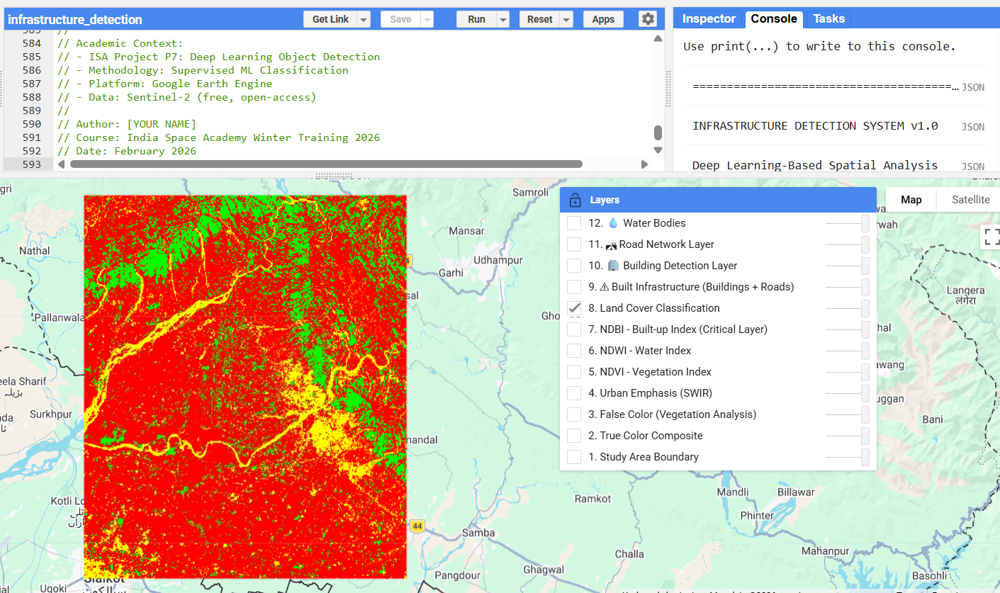
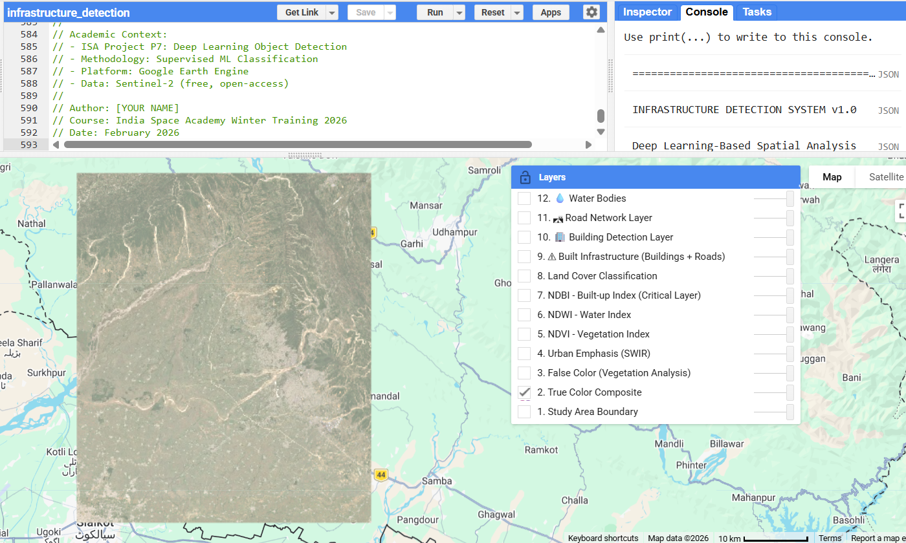
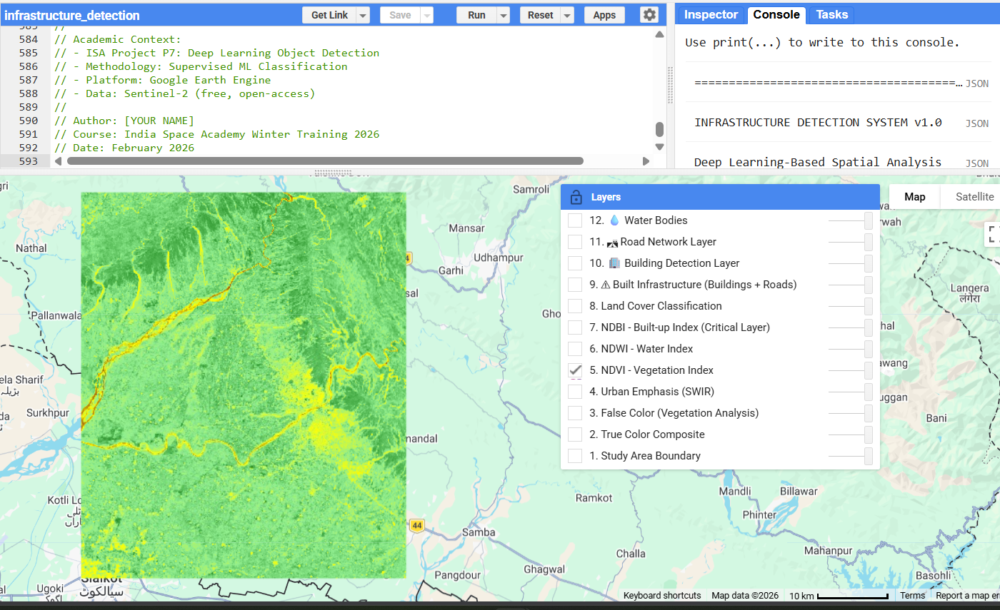
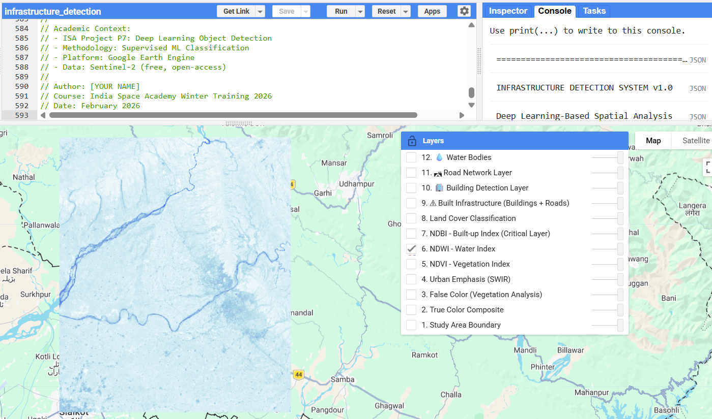

# Infrastructure Detection from Sentinel-2 Imagery

Land-cover mapping of a border region near Jammu using Sentinel-2 satellite imagery, spectral indices, and a Random Forest classifier, written for Google Earth Engine.

Built for Project P7 of the India Space Academy Winter Training Programme 2026.



## What it does

1. **Builds a cloud-free image.** Takes every Sentinel-2 surface-reflectance scene over the study area from 2023 with under 20% cloud cover and combines them with a per-pixel median.
2. **Computes three spectral indices** from the bands: NDVI (vegetation), NDWI (water) and NDBI (built-up surfaces).
3. **Generates training labels from index thresholds.** For example, a pixel with NDBI above 0.10 and NDVI below 0.30 is labelled "building".
4. **Trains a Random Forest** (100 trees) on a stratified sample of those labelled pixels, using 5 bands and the 3 indices as features.
5. **Classifies every pixel** into buildings, roads, water, vegetation or bare land, and reports the area of each class.

| | |
|---|---|
| Study area | 74.5–75.0°E, 32.5–33.0°N (roughly 2,600 km²) |
| Imagery | Sentinel-2 SR (`COPERNICUS/S2_SR`), 2023, bands B2, B3, B4, B8, B11 |
| Features | 5 bands + NDVI, NDWI, NDBI |
| Classifier | `ee.Classifier.smileRandomForest`, 100 trees, seed 42 |
| Platform | Google Earth Engine (JavaScript API) |

## Run it

1. Sign up for a free [Google Earth Engine](https://earthengine.google.com/) account.
2. Open the [Code Editor](https://code.earthengine.google.com).
3. Paste in [`code/infrastructure_detection.js`](code/infrastructure_detection.js) and press **Run**.
4. Toggle the layers on the map, and read the area statistics and confusion matrix in the Console tab.

## Outputs

| True colour | NDVI | NDWI |
|---|---|---|
|  |  |  |

More screenshots of each layer are in [`results/screenshots`](results/screenshots).

## How to read the accuracy

The script prints a confusion matrix, visible in [this console screenshot](results/screenshots/16-confusion-matrix-console.png). Two things matter when interpreting it:

- **It is training accuracy, not validation accuracy.** The matrix comes from `classifier.confusionMatrix()`, which scores the model on the same samples it was trained on. A Random Forest nearly always scores close to 100% on its own training data, so this number says little about real-world accuracy.
- **The labels come from the same indices the model sees.** The "ground truth" is produced by thresholds on NDVI, NDWI and NDBI, and those three indices are also input features. The model is largely learning to reproduce the thresholds.

In the recorded run, the water class received no training samples (its row in the matrix is all zeros), so water was not learned in that run.

An honest accuracy figure needs labels from an independent source, such as hand-digitised points or OpenStreetMap building footprints, and a held-out test set. See the next steps below.

## Limitations and next steps

- Roads are narrower than a 10 m pixel in most places, so separating them from buildings by NDBI alone is unreliable.
- Bare soil and built-up surfaces look similar in NDBI, which causes false "building" pixels on dry ground.
- Next: validate against independent reference data, add a train/test split, and try texture features or Sentinel-1 radar to separate buildings from bare soil.

## Repository layout

```
code/infrastructure_detection.js   the Earth Engine script
results/screenshots/               map layers and console output
report/                            project report (.docx)
WALKTHROUGH.md                     guided tour of the script
```

## References

- Gorelick et al. (2017). Google Earth Engine: Planetary-scale geospatial analysis for everyone. *Remote Sensing of Environment*, 202, 18–27.
- Breiman (2001). Random Forests. *Machine Learning*, 45(1), 5–32.
- Zha, Gao and Ni (2003). Use of normalized difference built-up index in automatically mapping urban areas from TM imagery. *International Journal of Remote Sensing*, 24(3), 583–594.
- McFeeters (1996). The use of the Normalized Difference Water Index (NDWI) in the delineation of open water features. *International Journal of Remote Sensing*, 17(7), 1425–1432.

## Author

Gauri Kishor, B.Tech CSE, SRM Institute of Science and Technology, Kattankulathur.

## License

MIT. See [LICENSE](LICENSE).
